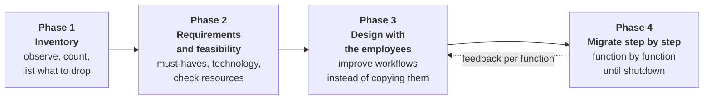
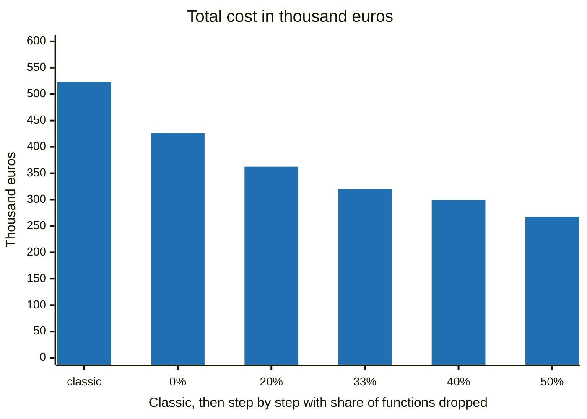

[Deutsche Fassung](README.md)

# Replacing Legacy Software

A guide for managing directors and IT managers: how to replace old business software, such as an ERP system, one function at a time, without a big cutover day, and in a way that employees actually adopt the new software.

By Simon Daniel März, ProjectMakers.

The detailed guide is written in German. This page summarises it. The instructions for coding agents are in English.

## What this is about

Replacing legacy software is not hard. The hard part is that the new software must really be better, must replace the old one completely, and that employees prefer it and use it fully instead of carrying on with the old system on the side.

Bringing employees along is what decides the outcome. The best software is worthless if nobody uses it fully and willingly.

This guide is not a step-by-step manual. It describes a path in four phases and names the points where it gets demanding.

## The four phases

| Phase | Key question | Details (German) |
|---|---|---|
| 1 Inventory | What does the software really do today, and what of it does anyone still need? | [01-bestandsaufnahme.md](leitfaden/01-bestandsaufnahme.md) |
| 2 Requirements and feasibility | What must the new software do, and what is actually possible in your company? | [02-anforderungen-und-machbarkeit.md](leitfaden/02-anforderungen-und-machbarkeit.md) |
| 3 Design with the employees | How do the workflows get better, and who helps shape them? | [03-konzept-mit-den-mitarbeitern.md](leitfaden/03-konzept-mit-den-mitarbeitern.md) |
| 4 Migrate step by step | How does one function after another move over until the old database is switched off? | [04-schrittweise-umziehen.md](leitfaden/04-schrittweise-umziehen.md) |

In phase 4, each new function first works on the old database through a bridge, and the old data is replicated into the new database. Developers know this approach as the [Strangler Fig pattern](https://martinfowler.com/bliki/StranglerFigApplication.html) described by Martin Fowler.

## What it costs: an example

An ERP-like system at a mid-sized company, with 60 functions and 40 employees who use it every day. All values are assumptions, including €120 per developer hour. Use your own values.

| | Classic, with a cutover date | Step by step |
|---|---|---|
| Development | 3,360 h = €403,200 | 2,420 h = €290,400 |
| Employees less efficient (training period) | €120,000 | €30,000 |
| Total | €523,200 | €320,400 |
| Every year after | Efficiency as before | about €144,000 less time spent |

The biggest lever is functions that nobody needs any more. In the table, a third of them are dropped. The chart shows the total cost when a different share is dropped.

Even if no function is dropped, the step-by-step path is not more expensive in this example. Trial runs for the big migration, the cutover weekend and the rework after the cutover date disappear or become much smaller. That offsets the bridge, the replication and the switching. Assumptions, formulas and what is not included are in [rechenbeispiel.md](rechenbeispiel.md) (German).

## For AI agents

A coding agent can prepare the inventory in the legacy code: list functions, screens, interfaces and database tables, and propose places for anonymous usage counters. The instructions are in [agents/inventory.md](agents/inventory.md). The result fits a project wiki that follows the pattern of ai-agent-wiki (ProjectMakers).

## Support

The path in this guide is doable, but it needs care in many places, above all while two databases run in parallel. If you plan a replacement and have questions or concerns, you can hire ProjectMakers for it. ProjectMakers works with contracts for work at a fixed total price, based on a requirements specification and a functional specification. The budget is fixed before the migration starts.

- Legacy modernisation at ProjectMakers: [projectmakers.de/services/legacy-modernization](https://projectmakers.de/services/legacy-modernization)
- Contact: [projectmakers.de/contact](https://projectmakers.de/contact)

## License

Texts and diagrams are licensed under [Creative Commons Attribution 4.0 International (CC BY 4.0)](https://creativecommons.org/licenses/by/4.0/). You may share and adapt them, including for commercial use. Credit the author as "Simon Daniel März, ProjectMakers", link to the license and indicate any changes. The full license text is in [LICENSE](LICENSE).
