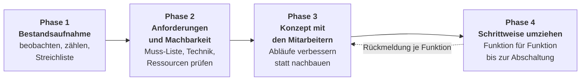
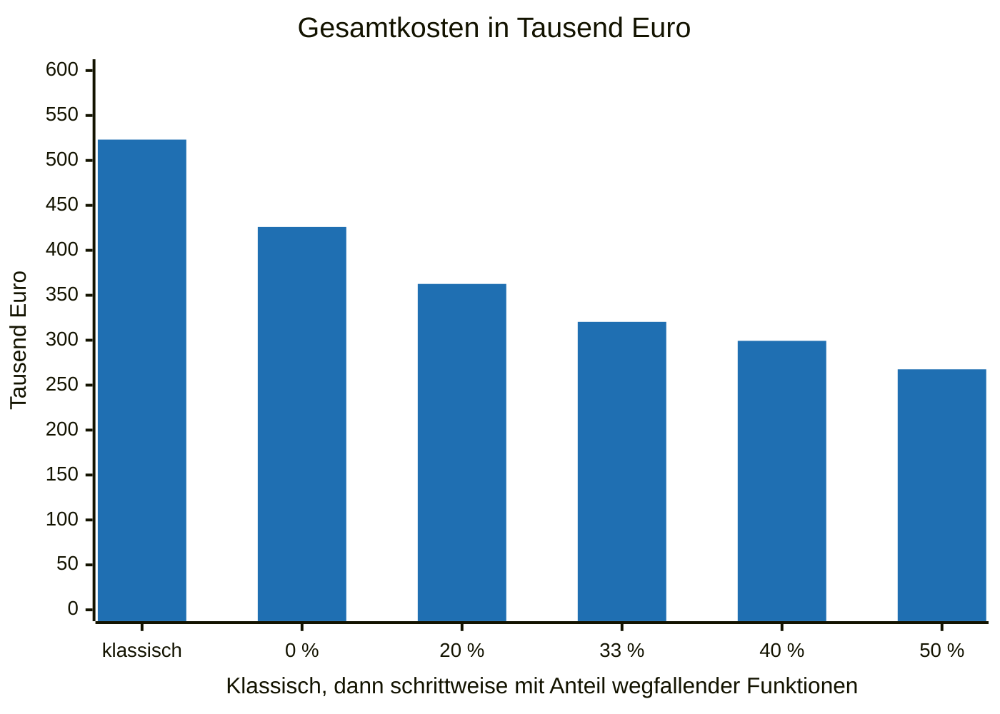

[English version](README.en.md)

# Legacy-Software ablösen

Ein Leitfaden für Geschäftsführer und IT-Leiter: wie Sie alte Unternehmenssoftware, etwa ein ERP, Funktion für Funktion ersetzen, ohne großen Umstellungstag und so, dass Ihre Mitarbeiter die neue Software wirklich annehmen.

Von Simon Daniel März, ProjectMakers.

## Worum es geht

Legacy-Software zu ersetzen ist nicht schwer. Schwer ist, dass die neue Software wirklich besser ist, die alte vollständig ersetzt und die Mitarbeiter sie lieber und vollständig nutzen, statt nebenher mit der alten weiterzuarbeiten.

Die Mitarbeiter mitzunehmen ist das Entscheidende. Die beste Software nützt nichts, wenn sie niemand vollständig und gern nutzt.

Dieser Leitfaden ist keine Schritt-für-Schritt-Anleitung. Er zeigt einen Weg in vier Phasen und benennt die Stellen, an denen es anspruchsvoll wird.

## Die vier Phasen

| Phase | Kernfrage | Mehr dazu |
|---|---|---|
| 1 Bestandsaufnahme | Was tut die Software heute wirklich, und was davon braucht noch jemand? | [01-bestandsaufnahme.md](leitfaden/01-bestandsaufnahme.md) |
| 2 Anforderungen und Machbarkeit | Was muss die neue Software können, und was ist in Ihrem Haus überhaupt möglich? | [02-anforderungen-und-machbarkeit.md](leitfaden/02-anforderungen-und-machbarkeit.md) |
| 3 Konzept mit den Mitarbeitern | Wie werden die Abläufe besser, und wer gestaltet mit? | [03-konzept-mit-den-mitarbeitern.md](leitfaden/03-konzept-mit-den-mitarbeitern.md) |
| 4 Schrittweise umziehen | Wie wandert eine Funktion nach der anderen um, bis die alte Datenbank abgeschaltet ist? | [04-schrittweise-umziehen.md](leitfaden/04-schrittweise-umziehen.md) |

## Was das kostet: ein Rechenbeispiel

Ein ERP-artiges System eines Mittelständlers mit 60 Funktionen und 40 Mitarbeitern, die täglich damit arbeiten. Alle Werte sind Annahmen, darunter 120 € pro Entwicklerstunde. Setzen Sie Ihre eigenen Werte ein.

| | Klassisch mit Stichtag | Schrittweise |
|---|---|---|
| Entwicklung | 3.360 h = 403.200 € | 2.420 h = 290.400 € |
| Mitarbeiter weniger effizient (Einarbeitung) | 120.000 € | 30.000 € |
| Gesamt | 523.200 € | 320.400 € |
| Danach jedes Jahr | Effizienz wie vorher | ca. 144.000 € weniger Zeitaufwand |

Der größte Hebel sind Funktionen, die niemand mehr braucht. In der Tabelle fällt ein Drittel weg. Das Diagramm zeigt die Gesamtkosten, wenn ein anderer Anteil wegfällt.

Selbst wenn keine Funktion wegfällt, ist der schrittweise Weg in diesem Beispiel nicht teurer. Probeläufe für die große Migration, das Umstellungswochenende und die Nacharbeit nach dem Stichtag fallen weg oder werden deutlich kleiner. Das gleicht Brücke, Replikation und Umschalten aus. Annahmen, Formeln und alles, was nicht eingerechnet ist, stehen in [rechenbeispiel.md](rechenbeispiel.md).

## Für KI-Agenten

Einen Coding-Agenten können Sie die Bestandsaufnahme im Altcode vorbereiten lassen: Funktionen, Masken, Schnittstellen und Datenbanktabellen inventarisieren und Stellen für anonyme Nutzungszähler vorschlagen. Die Anweisung dafür steht auf Englisch in [agents/inventory.md](agents/inventory.md), weil Coding-Agenten überwiegend auf Englisch arbeiten. Das Ergebnis passt in ein Projekt-Wiki nach dem Muster von ai-agent-wiki (ProjectMakers).

## Unterstützung

Der Weg in diesem Leitfaden ist machbar, aber er verlangt Sorgfalt an vielen Stellen, vor allem beim Parallelbetrieb zweier Datenbanken. Wenn Sie eine Ablösung planen und dazu Fragen oder Bedenken haben, können Sie ProjectMakers damit beauftragen. ProjectMakers arbeitet mit Werkverträgen und einem festen Gesamtpreis auf Grundlage von Lasten- und Pflichtenheft. Das Budget steht fest, bevor der Umzug beginnt.

- Legacy-Modernisierung bei ProjectMakers: [projectmakers.de/services/legacy-modernization](https://projectmakers.de/services/legacy-modernization)
- Kontakt: [projectmakers.de/contact](https://projectmakers.de/contact)

## Lizenz

Texte und Diagramme stehen unter der Lizenz [Creative Commons Namensnennung 4.0 International (CC BY 4.0)](https://creativecommons.org/licenses/by/4.0/deed.de). Sie dürfen sie teilen und bearbeiten, auch kommerziell. Nennen Sie dabei den Urheber „Simon Daniel März, ProjectMakers", verweisen Sie auf die Lizenz und kennzeichnen Sie Änderungen. Der vollständige Lizenztext steht in [LICENSE](LICENSE).
