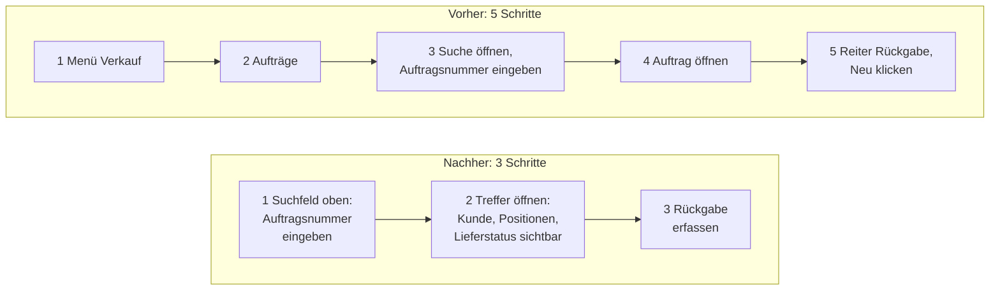

# Phase 3: Konzept mit Kunde und Mitarbeitern

Ziel: ein technisches und fachliches Konzept, das mit den Menschen entsteht, die später damit arbeiten. Nicht nur mit der Geschäftsführung.

## Abläufe verbessern statt nachbauen

Nehmen Sie die beobachteten Abläufe aus [Phase 1](01-bestandsaufnahme.md) und fragen Sie bei jedem: Wo braucht es heute fünf Klicks für eine Funktion, und wo reichen drei, ohne dass Information verloren geht?

Ein neutrales Beispiel, eine Rückgabe erfassen:

Zwei Schritte pro Vorgang klingen nach wenig. Bei einem Vorgang, der hundertmal am Tag vorkommt, sind es zweihundert Klicks. Mit solchen Stellen verdient die neue Software ihre Akzeptanz.

## Die richtigen Leute fragen

Fragen Sie die Menschen, die die Arbeit wirklich machen. Die Abteilungsleitung weiß, was herauskommen soll. Wie der Weg dahin im Alltag aussieht, weiß die Sachbearbeitung.

Zeigen Sie früh etwas zum Anfassen: einen klickbaren Entwurf oder eine Skizze auf Papier. Über eine Maske, die man sieht, reden Menschen konkreter als über ein Dokument. Unsere Erfahrung aus solchen Projekten: Menschen gehen sehr viel positiver mit neuer Software um, wenn sie an ihrer Entstehung beteiligt waren.

Beteiligung heißt nicht, jeden Wunsch umzusetzen. Wer einen Vorschlag gemacht hat, der nicht umgesetzt wird, braucht eine Begründung. Fehlt sie, schlägt die Beteiligung ins Gegenteil um.

In dieser Phase finden Sie auch die Pilotgruppe für Phase 4: Mitarbeiter, die Lust auf das Neue haben und bereit sind, als Erste live damit zu arbeiten.

## Technisches Konzept

Das fachliche Konzept sagt, was die Software tun soll. Das technische Konzept sagt, wie der Umzug funktioniert:

- Das neue Datenmodell und die Zuordnung der alten Tabellen und Felder zum neuen.
- Die Brücke: wie das neue System während des Umzugs die alte Datenbank liest und beschreibt.
- Die Replikation: welche Daten ab welchem Tag in die neue Datenbank übertragen werden und wie Fehler auffallen.
- Die Reihenfolge der Funktionen. Beginnen Sie mit einer Funktion, die überschaubar ist, regelmäßig genutzt wird und bei der ein Fehler nicht sofort den Versand oder die Buchhaltung stoppt.

## Ergebnis der Phase

- Abgestimmte Abläufe und Entwürfe der wichtigsten Masken.
- Datenmodell, Zuordnung alt zu neu, Konzept für Brücke und Replikation.
- Die Reihenfolge der Funktionen und eine Pilotgruppe.

## Fragen zum Nachdenken

- Welcher Ablauf wird in Ihrem Haus am häufigsten ausgeführt, und wie viele Schritte braucht er heute?
- Wer aus der Sachbearbeitung sitzt bei den Entwürfen mit am Tisch?

---

[Übersicht](../README.md) | Zurück: [Phase 2](02-anforderungen-und-machbarkeit.md) | Weiter: [Phase 4: Schrittweise umziehen](04-schrittweise-umziehen.md)
