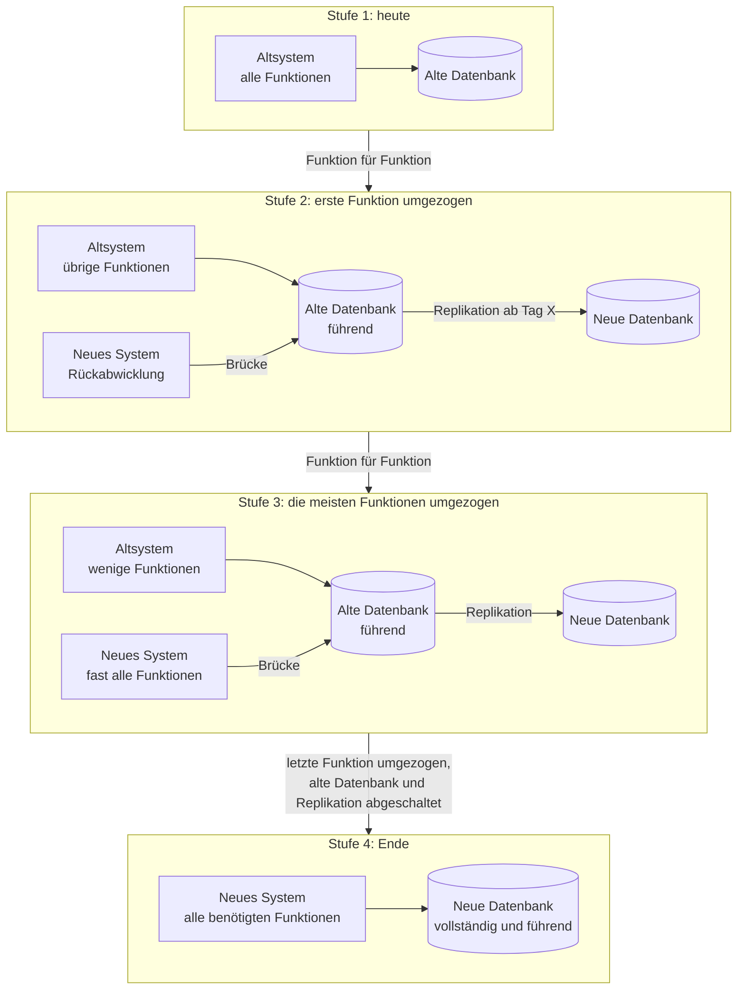
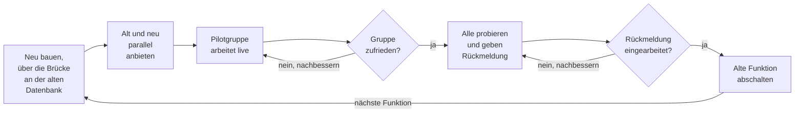

# Phase 4: Schrittweise umziehen

Ziel: Das Altsystem wird Funktion für Funktion abgelöst, ohne großen Umstellungstag. Am Ende läuft nur noch das neue System mit einer vollständigen neuen Datenbank.

Entwickler kennen dieses Vorgehen als Strangler Fig Pattern. Martin Fowler hat es nach der Würgefeige benannt, die um einen Wirtsbaum herumwächst, bis sie allein steht. Das neue System wächst um das alte herum, bis das alte nicht mehr gebraucht wird ([Martin Fowler: Strangler Fig, martinfowler.com, Stand 22.08.2024](https://martinfowler.com/bliki/StranglerFigApplication.html)).

## Das Prinzip am Beispiel eines ERP

Die erste Funktion ist die Rückabwicklung. Sie wird im neuen System gebaut und greift über eine Schnittstelle, die Brücke, auf die alte Datenbank zu. Die alte Datenbank bleibt bis zum Schluss die führende. Ab einem festgelegten Tag X werden ihre Daten laufend in die neue Datenbank repliziert. Danach folgt die nächste Funktion, dann die übernächste.

## Der Ablauf je Funktion

Jede Funktion durchläuft denselben Kreislauf. Am besten ziehen Sie eine Funktion jeweils vollständig um. Wer für einen einzigen Vorgang zwischen zwei Programmen wechseln muss, wird mit keinem von beiden zufrieden.

Solange die alte Funktion noch läuft, gibt es einen Rückweg. Die Pilotgruppe kann bei einem Problem zurück in die gewohnte Maske, und die Arbeit bleibt nicht liegen. Die Nutzungszähler aus [Phase 1](01-bestandsaufnahme.md) zeigen Ihnen, ob die alte Funktion nach dem Start der neuen noch benutzt wird. Wenn ja, fragen Sie nach dem Grund, bevor Sie abschalten. Oft fehlt der neuen Funktion noch etwas.

## Das Ende

Nach der letzten Funktion arbeitet das neue System nicht mehr über die Brücke, sondern direkt mit der neuen Datenbank. Die ist durch die Replikation vollständig. Danach schalten Sie Replikation und alte Datenbank ab. Prüfen Sie vorher, ob wirklich alles angekommen ist, etwa über Anzahlen und Summen je Tabelle. Denken Sie an die Aufbewahrungspflichten aus [Phase 2](02-anforderungen-und-machbarkeit.md): Eine schreibgeschützte Kopie der alten Datenbank kann nötig bleiben.

Das Ergebnis: kein großer Migrationstag. Die Mitarbeiter konnten jede Funktion ausprobieren und mitgestalten, bevor die alte wegfiel. Die Software ist im Unternehmen angekommen.

## Wo es knifflig wird

Der schrittweise Weg nimmt das Risiko eines einzigen Stichtags heraus. Dafür bringt er eigene Schwierigkeiten mit, die Sie kennen sollten, bevor Sie anfangen.

- Zwei Datenbanken stimmig halten. Die Replikation übersetzt das alte Datenmodell in das neue. Jede Regel dieser Übersetzung muss stimmen, und Abweichungen fallen oft erst Wochen später auf. Sie brauchen einen automatischen Abgleich, der regelmäßig läuft und meldet, wenn etwas nicht passt.
- Schreibzugriffe aus beiden Systemen. Alt- und Neusystem schreiben in dieselbe Datenbank, manchmal in denselben Datensatz. Das Altsystem prüft beim Speichern oft Regeln, die nur in seinem Programmcode stehen. Das neue System muss diese Regeln kennen und einhalten, sonst entstehen Datensätze, mit denen das Altsystem nicht umgehen kann.
- Neue Felder. Neue Funktionen brauchen oft Daten, die das alte Modell nicht kennt. Ob diese Daten in der alten oder der neuen Datenbank liegen, ist eine Entscheidung mit Folgen für Replikation und Abschaltung.
- Replikationsfehler. Die Replikation kann stocken oder einzelne Datensätze verlieren. Jemand muss das bemerken, bevor es die Mitarbeiter bemerken, und es muss einen erprobten Weg geben, die Lücke zu schließen.
- Die Brücke selbst. Ein Fehler in der Brücke kann Daten in der alten Datenbank beschädigen und damit alle treffen, die noch mit dem Altsystem arbeiten. Die Brücke gehört deshalb zu den am gründlichsten getesteten Teilen des Projekts.

Auch dieser Weg ist nicht frei von Fehlern und Störungen. Sie betreffen aber meist eine Funktion und eine kleine Gruppe, nicht das ganze Unternehmen an einem Tag.

An genau diesen Stellen hilft Erfahrung mit solchen Umzügen. Wenn Sie dabei Unterstützung möchten, können Sie ProjectMakers beauftragen: [Legacy-Modernisierung](https://projectmakers.de/services/legacy-modernization), [Kontakt](https://projectmakers.de/contact).

## Fragen zum Nachdenken

- Welche Funktion in Ihrem System wäre ein guter Anfang: überschaubar, regelmäßig genutzt, nicht geschäftskritisch?
- Wer in Ihrem Team merkt es, wenn die Replikation eine Nacht lang stillsteht?

---

[Übersicht](../README.md) | Zurück: [Phase 3](03-konzept-mit-den-mitarbeitern.md) | Weiter: [Rechenbeispiel](../rechenbeispiel.md)
