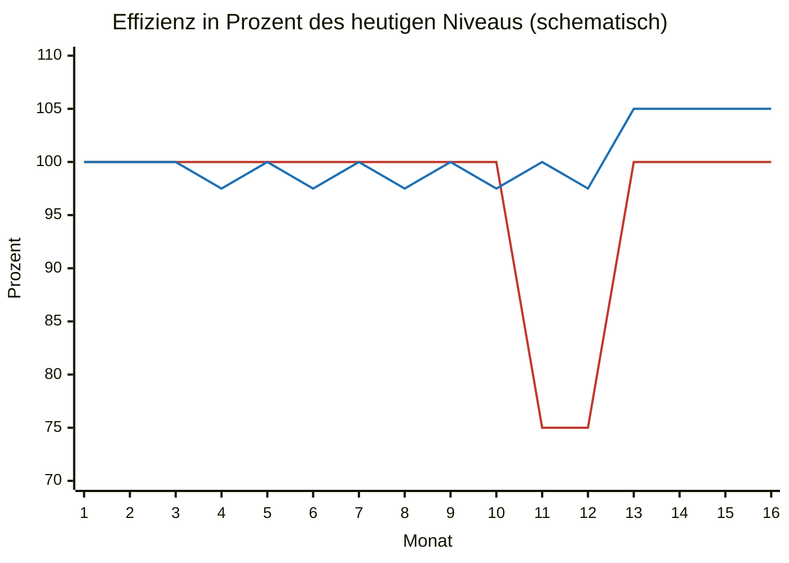

# Rechenbeispiel: klassisch oder schrittweise

Was kostet es, eine alte Unternehmenssoftware mit einem Stichtag zu ersetzen, und was kostet der schrittweise Weg aus diesem Leitfaden? Die folgende Rechnung vergleicht beide Wege an einem erfundenen Beispiel. Alle Zahlen sind Annahmen, keine Messwerte. Setzen Sie Ihre eigenen Werte ein. Die Formeln stehen weiter unten.

## Annahmen

- System: ERP-artige Software eines Mittelständlers mit 60 Funktionen.
- Entwicklung: im Schnitt 40 Stunden je Funktion.
- Stundensatz: 120 € pro Stunde. Setzen Sie Ihren eigenen Satz ein.
- Nutzer: 40 Mitarbeiter arbeiten täglich mit der Software.
- Arbeitszeit: 1.600 Stunden je Mitarbeiter und Jahr nach Urlaub und Krankheit, also rund 133 Stunden im Monat.
- Interne Kosten: 45 € je Mitarbeiterstunde.
- Klassischer Weg: Anforderungen nur mit dem Management, alle 60 Funktionen werden neu gebaut, Umstellung an einem Stichtag. Vor einem Stichtag sind Probemigrationen üblich, dazu kommt das Umstellungswochenende. Nach dem Stichtag melden alle Nutzer zur selben Zeit Fehler und fehlende Abläufe. Das erzeugt viel Nacharbeit. Danach arbeiten alle zwei Monate lang 25 % weniger effizient, bis sie eingearbeitet sind.
- Schrittweiser Weg: Bestandsaufnahme mit Beobachtung und Messung, ein Drittel der Funktionen fällt weg. Die Einarbeitung verteilt sich auf kleine Dellen je Funktion statt eines großen Einbruchs. Annahme: ein Viertel des klassischen Verlusts. Weitere Annahme: Weil die Mitarbeiter die Abläufe mitgestaltet haben, arbeiten sie danach 5 % effizienter.

## Vergleich

| Posten | Klassisch | Schrittweise |
|---|---|---|
| Bestandsaufnahme, Machbarkeit, Konzept | 120 h (nur mit dem Management) | 280 h (120 h Bestandsaufnahme, 160 h Machbarkeit und Konzept mit den Mitarbeitern) |
| Funktionen bauen | 2.400 h (alle 60) | 1.600 h (40, ein Drittel fällt weg) |
| Brücke zur alten Datenbank, Replikation, Umschalten je Funktion | 0 h | 400 h (240 h Brücke und Replikation, dazu 40 × 4 h Umschalten) |
| Datenmigration mit Probeläufen und Umstellungswochenende, vergessene Altdaten nachziehen | 400 h (360 h und 40 h) | 16 h (Abschalten am Ende) |
| Schulung und Nacharbeit nach dem Start | 440 h (40 h und 400 h) | 124 h (24 h und 100 h) |
| **Entwicklung gesamt** | **3.360 h = 403.200 €** | **2.420 h = 290.400 €** |
| Mitarbeiter weniger effizient (Einarbeitung) | 120.000 € (40 × 133,3 h × 2 Monate × 25 % ≈ 2.667 h × 45 €) | 30.000 € (ein Viertel des klassischen Verlusts) |
| **Gesamt** | **523.200 €** | **320.400 €** |
| Danach jedes Jahr | Effizienz wie vorher | 5 % effizienter: 40 × 1.600 h × 5 % = 3.200 h × 45 € = ca. 144.000 € weniger Zeitaufwand |

Ergebnis: Die Entwicklung ist auf dem schrittweisen Weg ca. 28 % günstiger, das Projekt insgesamt ca. 39 %. Dazu kommen jedes Jahr ca. 144.000 € weniger Zeitaufwand.

## Die Spanne: wie viel wegfällt

Die Ersparnis hängt vor allem davon ab, wie viele Funktionen nicht mehr gebraucht werden. In der Tabelle unten ändert sich nur dieser Anteil. Das Umschalten wächst mit, 4 Stunden je Funktion. Alle anderen Posten bleiben gleich.

| Anteil, der wegfällt | Funktionen | Entwicklung schrittweise | gegenüber klassisch (403.200 €) | Gesamt schrittweise | gegenüber klassisch (523.200 €) |
|---|---|---|---|---|---|
| 0 % | 60 | 3.300 h = 396.000 € | ca. 2 % günstiger | 426.000 € | ca. 19 % günstiger |
| 20 % | 48 | 2.772 h = 332.640 € | ca. 18 % günstiger | 362.640 € | ca. 31 % günstiger |
| ein Drittel | 40 | 2.420 h = 290.400 € | ca. 28 % günstiger | 320.400 € | ca. 39 % günstiger |
| 40 % | 36 | 2.244 h = 269.280 € | ca. 33 % günstiger | 299.280 € | ca. 43 % günstiger |
| 50 % | 30 | 1.980 h = 237.600 € | ca. 41 % günstiger | 267.600 € | ca. 49 % günstiger |

Selbst wenn keine Funktion wegfällt, ist der schrittweise Weg in diesem Beispiel nicht teurer. Probeläufe für die große Migration, das Umstellungswochenende und die Nacharbeit nach dem Stichtag fallen weg oder werden deutlich kleiner. Das gleicht Brücke, Replikation und Umschalten aus.

Wie realistisch ein Drittel ist, lesen Sie in [Phase 1](leitfaden/01-bestandsaufnahme.md#was-wegfallen-kann).

## Effizienz über die Zeit

Schematisch, nicht maßstäblich. Die Linie mit dem tiefen Einbruch ist der klassische Weg: Nach dem Stichtag arbeiten alle zwei Monate lang 25 % weniger effizient und kehren dann auf das alte Niveau zurück. Die andere Linie ist der schrittweise Weg: kleine Dellen bei jeder umgezogenen Funktion, zusammen ein Viertel des klassischen Verlusts, danach 5 % über dem alten Niveau.

## So rechnen Sie selbst

| Größe | Formel |
|---|---|
| Entwicklung klassisch | (Vorbereitung + Funktionen × Stunden je Funktion + Migration + Schulung) × Stundensatz |
| Entwicklung schrittweise | (Vorbereitung + verbleibende Funktionen × (Stunden je Funktion + Umschalten) + Brücke + Abschalten + Schulung) × Stundensatz |
| Einarbeitung klassisch | Mitarbeiter × Monatsstunden × Monate × Effizienzverlust × interner Stundensatz |
| Einarbeitung schrittweise | Einarbeitung klassisch × Anteil (hier ein Viertel) |
| Zeitersparnis je Jahr | Mitarbeiter × Jahresstunden × Effizienzgewinn × interner Stundensatz |

Die Stunden für Vorbereitung, Brücke, Migration, Abschalten und Schulung stehen in der Tabelle oben.

## Was nicht eingerechnet ist

- Betriebskosten des Altsystems bis zur Abschaltung. Sie fallen auf beiden Wegen an. Wie lange, hängt vom Projekt ab.
- Risiken des klassischen Wegs: Verzögerungen, Projektabbruch, Datenverluste. Sie würden den klassischen Weg teurer machen, sind aber schwer zu beziffern.
- Risiken des schrittweisen Wegs, etwa Fehler in Brücke oder Replikation. Die geplanten Kosten für Brücke, Replikation und Parallelbetrieb sind in der Tabelle enthalten. Weil jede Funktion zuerst mit einer kleinen Pilotgruppe live geht und die alte Funktion als Rückweg bereitsteht, fallen solche Fehler meist früh auf. Voraussetzung ist ein automatischer Abgleich der Daten, wie in [Phase 4](leitfaden/04-schrittweise-umziehen.md#wo-es-knifflig-wird) beschrieben.
- Verbesserungen während des Umzugs. Jede umgezogene Funktion kann schon vor dem Ende Zeit sparen. Die Rechnung zählt den Effizienzgewinn erst ab dem Ende.

---

[Übersicht](README.md) | Zurück: [Phase 4](leitfaden/04-schrittweise-umziehen.md)
